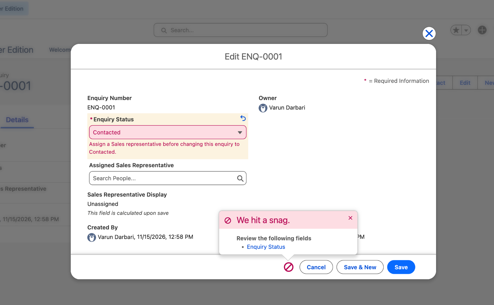
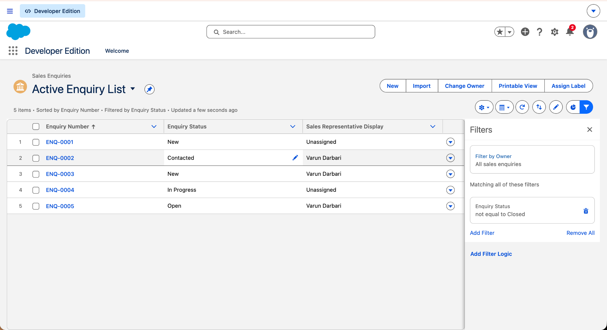

# Artefact 007 — Salesforce CRM Configuration & Functional Verification (MVP V1)

**Project:** Customer 360 — CRM Transformation & Customer Data Integration  
**Organisation:** Northstar Services (Fictional)  
**Document type:** IT Business Analysis — Implementation Evidence, Requirements Traceability & Development Verification  
**Version:** 1.0 — Evidence-reviewed publication candidate (not yet merged or deployed)  
**Status:** Scoped Salesforce MVP configuration and development tests reported by the author; six user-supplied screenshots reviewed; publishing and multi-user access verification pending  
**Prepared by:** Varun Kumar Darbari  
**Review date:** 17 November 2026

> **Evidence boundary.** Northstar Services is fictional. All demonstration enquiries and business scenarios are synthetic. Salesforce configuration and tests in this document were carried out by the author and reported during guided Session 7. Six screenshots provided by the author were visually reviewed and prepared for publication with browser-address details removed. This is **not** independent access to the authenticated Salesforce environment, nor evidence of production readiness, real stakeholder acceptance, multi-user authorisation, integration execution, a data migration or measured business outcomes. This document is a candidate for publication, not a deployed production system.

---

## 1. Executive summary

This artefact records a limited, hands-on Salesforce CRM demonstration constructed after the proposed design in [Artefact 006](06-crm-data-and-solution-design.md). It implements a narrow slice of the simulated Sales-enquiry requirements defined in [Artefact 004](04-requirements-catalogue.md): store an enquiry's status, permit a blank business-assigned Sales Representative, prevent a particular invalid status transition, and expose three views of enquiry ownership and activity. This is an **implemented case-study demonstration**, not a complete enterprise CRM system.

The author configured a Sales Enquiry custom object, two core business data fields, a read-only representative display formula, a status-change validation rule, six synthetic example records and three list views in Salesforce Developer Edition. User-executed development tests and a consolidated regression check were reported as passing in Session 7. Six subsequently supplied screenshots were reviewed: they directly show the three views and filters, the active validation formula, a blocked status change, and the persisted unchanged record. The evidence strengthens the demonstration but does not prove role-based access across multiple users. Publication and deployment checks are still outstanding.

The project deliberately keeps the technical Salesforce **Record Owner** separate from the optional Northstar **Assigned Sales Representative**. That distinction permits an enquiry to be `New` and *business-unassigned* even when Salesforce requires a technical owner for the record.

## 2. Traceability to earlier Northstar work

| Earlier source | Relevant baseline | How this session relates |
|---|---|---|
| [Artefact 001](01-business-context.md) | BO-02 | Improve visibility of enquiry ownership and follow-up responsibility |
| [Artefact 003](03-process-gap-analysis.md) | GAP-02 | Candidate enquiry capture, ownership and follow-up gap |
| [Artefact 004](04-requirements-catalogue.md) | BR-001–BR-004; FR-001–FR-005; DR-001–DR-003; AC-001–AC-004 | Author-selected simulated requirements and expected behaviour |
| [Artefact 005](05-customer-data-model-and-quality-analysis.md) | Synthetic Customer–Enquiry diagnostic data; VAL-01 candidate | SQL investigation is **separate** from this configured Salesforce demonstration; no database migration or Salesforce Customer lookup is claimed |
| [Artefact 006](06-crm-data-and-solution-design.md) | D-01–D-07, T-01–T-08 | Design options and test specifications preceding this implementation |

The **ENQ-0001 to ENQ-0006** identifiers below belong to the Salesforce demonstration. They are **not** the same records as the fictional SQL examples ENQ-201–204 in Artefact 005 or the acceptance-test illustration IDs ENQ-501–605 in Artefact 004. The previous documents retain their historical status and are not changed retroactively.

## 3. Selected MVP object and field design

| Salesforce component | Configuration selected or reported | Why it exists | Qualification |
|---|---|---|---|
| Custom object | Sales Enquiry (`Sales_Enquiry__c`) | Represent the case-study enquiry independently of standard Lead conversion | D-02: author-selected MVP implementation choice; not real stakeholder approval |
| Enquiry Number | Auto Number record name, display format `ENQ-{0000}` | Maintain a unique demonstration reference | DR-001; actual records ENQ-0001–0006 reported |
| Enquiry Status | Picklist `Enquiry_Status__c` | Support filtering and status-transition testing | DR-002; values `New`, `Contacted`, `Open`, `In Progress`, `Closed` are provisional demonstration values |
| Assigned Sales Representative | Optional Lookup(User) `Assigned_Sales_Representative__c` | Represent nullable *business* assignment separately from technical record ownership | DR-003, D-03; tested through saved records with this lookup blank |
| Sales Representative Display | Formula(Text) `Sales_Representative_Display__c` | Render `Unassigned` for blank lookup; otherwise render assigned user's name | FR-004; display only, not a stored identity |
| Record Owner | Salesforce's standard Owner field | Preserve platform record ownership | Not equivalent to Northstar's assigned Sales Representative |

The display formula reports a **read-only label**, not a separate identity record. The author reported that this formula passed Salesforce syntax checking and displayed the expected output:

```text
IF(
    ISBLANK(Assigned_Sales_Representative__c),
    "Unassigned",
    TRIM(
        Assigned_Sales_Representative__r.FirstName
        & " " &
        Assigned_Sales_Representative__r.LastName
    )
)
```

An earlier attempt referencing the User relationship's `.Name` failed syntax checking. This revised formula was **not independently inspected in Salesforce Setup**, but its visible output is demonstrated by evidence [E-03](../assets/evidence/07-e03-active-enquiry-view.png).

**In plain English:** the lookup stores either a Salesforce user reference or nothing. The formula presents the real user's name when available and the readable label `Unassigned` otherwise; it never populates the blank business-assignment lookup.

No Account/Contact customer association, Opportunity conversion, automated assignment, follow-up reminder, external integration, data import, reporting dashboard, or production security model was implemented in this scoped demonstration.

## 4. Implemented business rule BR-004

**Source requirement:** A new Sales enquiry without a business-assigned representative must not move from `New` to `Contacted`.

The author created and activated validation rule `BR004_Require_Assignee_For_Contacted` for the Sales Enquiry object. Evidence [E-04](../assets/evidence/07-e04-validation-rule.png) shows the Active checkbox, saved formula and error message. Its conditions are:

1. `Enquiry_Status__c` is changing.
2. The prior picklist value is `New`.
3. The requested picklist value is `Contacted`.
4. `Assigned_Sales_Representative__c` is blank at save time.

The saved error-condition formula shown in the configuration screenshot is:

```text
AND(
    ISCHANGED(Enquiry_Status__c),
    ISPICKVAL(PRIORVALUE(Enquiry_Status__c), "New"),
    ISPICKVAL(Enquiry_Status__c, "Contacted"),
    ISBLANK(Assigned_Sales_Representative__c)
)
```

The rule evaluates to TRUE only when every condition is satisfied. When TRUE, Salesforce blocks saving that change and shows the configured message:

> Assign a Sales representative before changing this enquiry to Contacted.

The rule does **not** automatically update the status when a representative is assigned. It also does not require the representative to have been assigned in an earlier transaction: a valid assignment and requested status change in the same save would be assessed against the values at save time. That combination was **not separately tested** in this session.

**Observed and reported outcomes:** Screenshot [E-05](../assets/evidence/07-e05-blocked-transition.png) shows an attempted change of ENQ-0001 to `Contacted` rejected because the assignment is blank; [E-06](../assets/evidence/07-e06-unchanged-record.png) shows its saved status remains `New` after the attempt (T-04). The author separately reported that an assigned `New` enquiry was allowed to change (T-06), and that assigning a representative alone left status `New` (T-05). These latter two actions were not captured as standalone before-and-after screenshots.



*Figure: Reproduced validation error in the Salesforce development environment; browser address removed from the published image.*

## 5. Synthetic Salesforce demonstration records

The author created six Salesforce demonstration records. Their reported state at the end of Task 7.8 is:

| Demonstration label | Enquiry number | Enquiry status | Assigned Sales Representative |
|---|---|---|---|
| Record A | ENQ-0001 | New | Blank |
| Record B | ENQ-0002 | Contacted | Signed-in Salesforce user |
| Record C | ENQ-0003 | New | Signed-in Salesforce user |
| Record D | ENQ-0004 | In Progress | Blank |
| Record E | ENQ-0005 | Open | Signed-in Salesforce user |
| Record F | ENQ-0006 | Closed | Signed-in Salesforce user |

All names, roles and records serve the simulated case study. This table is a reported final snapshot; the earlier test of Record B's status occurred while it was still `New`.

## 6. List-view implementation and functional verification

### 6.1 New Unassigned Enquiries — BR-001 / FR-001

**Filter behaviour:** `Enquiry Status = New` **AND** `Assigned Sales Representative = blank`, using the All Sales Enquiries record scope available to the signed-in tester.

**Result:** Evidence [E-01](../assets/evidence/07-e01-new-unassigned-view.png) shows `Enquiry Status equals New`, `Assigned Sales Representative equals` blank, filter logic `1 AND 2`, and **only ENQ-0001** returned. The initial four-record filtering test and consolidated six-record regression check were reported as passing. This supports filter logic under the author's account, not authorisation of a separate Sales Manager.

### 6.2 My Assigned Enquiries — BR-002 / FR-002

**Filter behaviour:** `Assigned Sales Representative equals $USER` for the currently signed-in user; no status restriction.

**Result:** Evidence [E-02](../assets/evidence/07-e02-my-assigned-view.png) shows `Assigned Sales Representative equals $USER`, with ENQ-0002, ENQ-0003, ENQ-0005 and **Closed ENQ-0006** included. Blank-assignment ENQ-0001 and ENQ-0004 are excluded. The screenshot tests the signed-in administrator only; it does not demonstrate isolation between two representative accounts.

**Correction during testing:** The first attempt displayed all six records because the custom lookup filter had not been saved. After the filter was saved, the expected four records appeared. This was an actual configuration/testing issue resolved without deleting test data. The `$USER` behaviour has only been exercised with the author's signed-in user; a second-user test remains outstanding.

### 6.3 Active Enquiry List — BR-003 / FR-003 / FR-004

**Filter behaviour:** `Enquiry Status not equal to Closed` with All Sales Enquiries record scope. The display column uses a read-only formula showing the Salesforce User's name if assigned and `Unassigned` if blank.

**Result:** Evidence [E-03](../assets/evidence/07-e03-active-enquiry-view.png) shows five records ENQ-0001–0005, a `not equal to Closed` filter and the display column. ENQ-0001 and ENQ-0004 show the literal `Unassigned`, while the other three records show the assigned Salesforce user. ENQ-0006 is not listed.

**Correction during testing:** The initial formula using the related User's `.Name` did not pass Salesforce syntax checking. A revised formula combining the related User's `FirstName` and `LastName` was accepted, and the screenshot confirmed the expected display. The original blank business assignments remain blank.



*Figure: Current-user view and display outcome with the filter visible; browser address removed.*

## 7. Development test and regression evidence register

| Test / checkpoint | Behaviour tested | Author-reported actual result | Status | Important limit |
|---|---|---|---|---|
| DR-003 smoke test | Create New enquiry without business assignment | Record A saved with blank assignment | Pass — saved record E-06 reviewed | Tested via one form and one user |
| T-05 / AS-05 | Assign rep without changing New status | Record B remained `New` on assignment | Pass — self-reported | Record B was subsequently changed to Contacted during T-06 |
| T-04 / BR-004 | Change unassigned New enquiry to Contacted | Validation rejected status update | Pass — screenshots E-05/E-06 reviewed | Only this path/record shown |
| T-06 / BR-004 | Change assigned New enquiry to Contacted | Status update saved | Pass — author-reported; final status in E-02 | No screenshot of the successful save action |
| T-01 equivalent / FR-001 | New and unassigned view logic | Only ENQ-0001 included among current six records | Pass — self-reported | Not tested with a separate Sales Manager |
| T-02 partial / FR-002 | Current user's business assignments across statuses | B, C, E, F included, including Closed F | Pass — screenshot E-02 reviewed | Second-representative exclusion and access controls untested |
| T-03 partial / FR-003–004 | Active view and Unassigned display | A–E included; F excluded; A/D show Unassigned | Pass — screenshot E-03 reviewed | Manager permissions untested |
| 7.8 regression | Re-open three views; verify BR-004 is Active | All three views matched and rule remained Active | Pass — self-reported; screenshot consistency checked | Live authenticated environment not accessed independently |

The original acceptance criteria in Artefact 004 remain specifications for the fictional scenario. The tests above use **new** Salesforce demonstration fixtures; they should not be represented as literal execution against earlier ENQ-501–605 records. The simulated management authorisation and inter-user visibility requirements have not been fully exercised.

## 8. Screenshot evidence and review register

The evidence was supplied by the author during Session 7 and visually inspected in this review. The six images below **represent five evidence groups**: three list-view outcomes, one validation configuration, and the blocked transition together with its unchanged saved record. The publication copies crop out the browser's Salesforce organisation address and, for focused screenshots, unrelated browser/page chrome. They do not alter the test-result tables or validation error.

| Evidence | File | Directly visible proof | Limitation |
|---|---|---|---|
| E-01 — New Unassigned | [Screenshot](../assets/evidence/07-e01-new-unassigned-view.png) | Both AND filters; ENQ-0001 only | Tested using current signed-in account |
| E-02 — My Assigned | [Screenshot](../assets/evidence/07-e02-my-assigned-view.png) | `$USER` lookup filter; ENQ-0002/0003/0005/0006; Closed included | No independent second-representative account |
| E-03 — Active and display | [Screenshot](../assets/evidence/07-e03-active-enquiry-view.png) | `not equal to Closed`; five records; `Unassigned` for ENQ-0001/0004 | Manager access not separately tested |
| E-04 — Saved validation rule | [Screenshot](../assets/evidence/07-e04-validation-rule.png) | BR-004 rule name; Active checkbox; formula and message | Does not alone prove execution |
| E-05 — Blocked change | [Screenshot](../assets/evidence/07-e05-blocked-transition.png) | ENQ-0001 attempted `Contacted`, blank business assignment and validation error | One specific transition scenario |
| E-06 — Persisted state | [Screenshot](../assets/evidence/07-e06-unchanged-record.png) | ENQ-0001 remains `New`; technical Owner populated; business assignment blank | Does not prove unrelated transitions |

**What the screenshots do not establish:** a complete setup export of every custom field, a second signed-in user, manager/representative permissions, an integration, a production rollout, or a successful-save screenshot for T-06. The field design and T-05/T-06 results are reported from the author's earlier executed tasks; they should not be silently upgraded to independently observed evidence.

**How to reproduce the key check:** in a Salesforce Developer Edition with the described object and fields, create a `New` enquiry with no business-assigned representative, attempt to change its status to `Contacted` and save. BR-004 should reject that attempted update and preserve the previously saved `New` status. To test the allowed comparison, use an otherwise equivalent enquiry whose business-assignment User lookup is populated.

**Publication handling:** the six cropped images in `assets/evidence/` are included with this document in the companion package. They contain the author's professional Salesforce display name because it identifies the assigned test user; the browser host and URL identifiers have been removed. The source captures remain outside GitHub, unless explicitly needed for an audit. The screenshots are evidence of a fictional development exercise and must not be presented as client or production records.

## 9. Decisions, deviations and outstanding work

- **D-02 selected for the demonstration:** `Sales_Enquiry__c` custom object instead of a standard Lead for this limited case-study scope. The original Artefact 006 recorded it as open *before* the build; that historical statement is preserved.
- **D-03 selected for the demonstration:** separate technical Salesforce Record Owner and nullable business assignment Lookup(User).
- **D-04 provisionally selected:** demonstration statuses `New`, `Contacted`, `Open`, `In Progress` and `Closed`; no full lifecycle agreement is claimed.
- **D-01 deferred:** Customer association and the tension with Artefact 005 candidate VAL-01 remain unresolved; no custom Customer lookup or customer migration is claimed.
- **D-05–D-07 partly or wholly open:** deletion/merge treatment, optional follow-up/description fields and full assignment/editing permissions not baselined or tested.
- **Access limitation:** The views were created as private list views for the author's signed-in user. A separate Sales Manager and a separate Sales Representative were not used to test visibility and permissions.
- **No integrations or UAT:** API integrations, production security, executed business-user acceptance testing, analytics dashboards and real-world outcomes remain outside the demonstrated work.
- **List-view metadata housekeeping:** A screenshot URL for the `New Unassigned Enquiries` view contained the internal filter API identifier `Accept_the_generated_value`. That label is not evidence of a filtering error; it is an optional naming cleanup for later, not grounds to recreate or delete a working view.
- **Evidence gap:** An object/field-definition screenshot and a dedicated successful T-06 save screenshot have not been collected. This case study labels the corresponding configuration and test-result claims appropriately.

## 10. Conclusion and case-study disposition

**Completed and reported in Session 7:** A limited Sales Enquiry Salesforce demonstration, the core ownership/status data fields, a display formula, BR-004 validation, three list views, six synthetic records and user-executed behaviour/regression checks. The implementation illustrates a direct trace from case-study requirements to configured CRM behaviour and observed development test outcomes.

**Publication candidate, not yet deployed:** Six redacted evidence images have been prepared and visually reviewed. The Markdown is ready for a GitHub feature-branch review, but public-page generation, CI, visual acceptance on desktop/mobile and post-merge regression checks remain pending. Multi-user authorisation, the object/field setup screenshot and other deferred work remain explicit limitations. The README and main professional portfolio must only be updated after the full release passes verification.

**Publishing method:** Retain this Markdown in `docs/` as the master. Add a new reading-guide entry and adjust the generator to treat only the six legacy pages as archived history; a newly created seventh artefact has no historical overview. Regenerate the public HTML, check all seven pages and original links, and perform the mandatory pre-merge and post-deployment regression audit. Do not rewrite Artefacts 001–006 to change their historical status.

---

**Related sources:** [Artefact 004](04-requirements-catalogue.md) · [Artefact 005](05-customer-data-model-and-quality-analysis.md) · [Artefact 006](06-crm-data-and-solution-design.md) · [Publishing guidance](../PUBLISHING.md)
