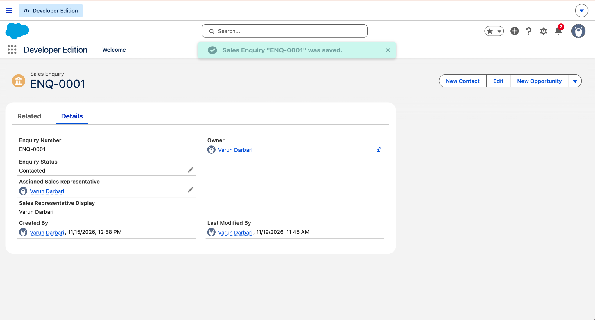

# Artefact 008 Northstar MVP V1 Sales Enquiry Verification

**Project:** Northstar Customer 360  
**Author:** Varun Kumar Darbari  
**Review date:** 20 November 2026  
**Version:** 1.0  
**Status:** Session 8 development verification complete for the tested scope

## 1 What was verified

The Salesforce Sales Enquiry demonstration produced the expected results for the tested view filters, representative display, assignment-only save and two New-to-Contacted scenarios. After testing, ENQ-0001 was restored to New with no Assigned Sales Representative; the three refreshed views again matched the six-record baseline. No unexpected outcome was observed in the supplied Session 8 evidence.

This report connects those observations to the requirements in [Artefact 004](04-requirements-catalogue.md), the proposed tests in [Artefact 006](06-crm-data-and-solution-design.md) and the implemented configuration in [Artefact 007](07-salesforce-crm-configuration-and-functional-verification.md). It supports a bounded enquiry-management demonstration. It does not establish completion of the broader Customer 360 vision or every role-based acceptance criterion.

Northstar Services is fictional. Varun executed the Salesforce actions in his development environment and supplied screenshots for guided review. The reviewer did not independently access the authenticated environment. Business-user UAT, real stakeholder acceptance, production deployment and business benefits are not claimed.

## 2 Requirements and verification scope

| Source | Behaviour checked | Evidence boundary |
|---|---|---|
| BR-001 and FR-001 | New Unassigned requires New AND blank business assignment | Filtering checked under the current account; separate manager authorisation untested |
| BR-002 and FR-002 | My Assigned matches the current business assignee across all statuses, including Closed | Current-user and blank-assignment cases checked; another representative and cross-user permissions untested |
| BR-003 and FR-003 | Active excludes Closed | Six-record sample checked under the current account |
| FR-004 | Show the assignee name or Unassigned | Both populated and blank assignments shown |
| BR-004 and FR-005 | Reject New to Contacted when business assignment is blank | One blocked update and its unchanged saved record captured |
| AS-05 | Assignment alone does not change New status | ENQ-0001 before and after assignment captured |
| T-06 in Artefact 006 | Allow the comparison transition with an existing assignee | Successful save captured; separate post-refresh Contacted screenshot not supplied |

The logical business assignment maps to `Assigned_Sales_Representative__c`, a nullable User lookup. Salesforce Record Owner remains separate. The displayed word `Unassigned` does not populate the lookup. Screenshot evidence supports stored status and assignment on the specific records shown; it is not a complete field-definition export or an exhaustive uniqueness test.

The original acceptance examples ENQ-501–605, the SQL fixtures ENQ-201–204 and the Salesforce records ENQ-0001–0006 are different datasets. These tests exercise corresponding behaviours; they are not literal execution of every original sample acceptance criterion.

## 3 Test data and execution sequence

| Enquiry | Baseline status | Assigned Sales Representative |
|---|---|---|
| ENQ-0001 | New | Blank |
| ENQ-0002 | Contacted | Varun Darbari |
| ENQ-0003 | New | Varun Darbari |
| ENQ-0004 | In Progress | Blank |
| ENQ-0005 | Open | Varun Darbari |
| ENQ-0006 | Closed | Varun Darbari |

The baseline capture was supplied on 18 November; the verification captures were supplied on 20 November 2026, using the author's local capture dates. Salesforce displays its own record timestamps; this report does not equate those timestamps with the screenshot timezone.

The first three checks inspected views and their filters. ENQ-0001 then supplied a controlled sequence: attempt Contacted without assignment and observe rejection; inspect New with blank assignment; assign Varun while retaining New; change New to Contacted with Varun retained; restore New and blank assignment; refresh all three views. Configuration evidence was captured last. No configuration fix was made during this sequence.

## 4 Reproducible test results

### T-01 New Unassigned Enquiries

Open the view with all Sales enquiries available to the tester. Inspect `Enquiry Status equals New`, `Assigned Sales Representative equals` blank and logic `1 AND 2`. Expected and actual: only ENQ-0001 appears, with New and a blank assignment. New assigned ENQ-0003 and In Progress unassigned ENQ-0004 are excluded. **Pass for filtering on this dataset.** Separate manager access is untested. Evidence E08-02.

### T-02 My Assigned Enquiries

Open the view and inspect `Assigned Sales Representative equals $USER`, with no status restriction. Expected and actual: ENQ-0002, ENQ-0003, ENQ-0005 and Closed ENQ-0006 appear, all assigned to Varun; blank-assignment ENQ-0001 and ENQ-0004 are excluded. **Pass for the tested current-user subset; original multi-user scenario incomplete.** There is no second representative's record in this dataset and no second signed-in user. Evidence E08-03.

### T-03 Active Enquiry List and display

Open the view and inspect `Enquiry Status not equal to Closed`. Expected and actual: ENQ-0001–0005 appear; Closed ENQ-0006 is excluded. ENQ-0001 and ENQ-0004 display Unassigned; the other three show Varun Darbari. **Pass for filtering and display under the current account.** Separate manager permissions are untested. Evidence E08-04.

### T-04 Reject unassigned New to Contacted

Start with ENQ-0001 saved as New and business assignment blank. Edit its status to Contacted and save without assigning a representative. Expected and actual: Salesforce rejects the save with `Assign a Sales representative before changing this enquiry to Contacted.` The subsequent record detail shows New, blank business assignment and Unassigned display. **Pass for this record and transition.** Evidence E08-05 and E08-06.

### T-05 Assignment without status change

From the same New, unassigned ENQ-0001, select Varun Darbari in Assigned Sales Representative, leave status New and save. Expected and actual: the record detail shows New, Varun Darbari in the lookup and Varun Darbari in the display. Assignment did not automatically change status. **Pass for the observed assignment-only save.** Evidence E08-06 before and E08-07 after.

### T-06 Allow assigned New to Contacted

From ENQ-0001 saved as New with Varun assigned, change only status to Contacted and save. Expected and actual: Salesforce reports that ENQ-0001 was saved; details show Contacted and unchanged Varun assignment and display. **Pass for the successful save shown.** Evidence E08-07 before and E08-08 after. The user was instructed to refresh or reopen before restoration, but a separate screenshot or explicit report of that intermediate Contacted persistence check was not supplied. Do not claim independent post-refresh verification of that state.

### Restore the baseline and check existing views

Set ENQ-0001 back to New and clear Assigned Sales Representative, leaving Record Owner unchanged. Salesforce confirms the save; details show New, blank assignment and Unassigned display. The subsequent refreshed views show the expected baseline results below. **Pass for restoration and the three observed view checks.** Evidence E08-09–E08-12.

| Refreshed view | Expected and observed records | Count |
|---|---|---:|
| New Unassigned | ENQ-0001 | 1 |
| My Assigned | ENQ-0002, ENQ-0003, ENQ-0005, ENQ-0006 | 4 |
| Active | ENQ-0001, ENQ-0002, ENQ-0003, ENQ-0004, ENQ-0005 | 5 |

These are regression checks after test-data changes. They are not retests following a newly fixed defect, and they do not add new transition or security coverage.

## 5 Active validation configuration

Evidence E08-13 shows `BR004_Require_Assignee_For_Contacted` with Active checked, the error on Enquiry Status and this saved formula, transcribed with formatting normalised:

```text
AND(
    ISCHANGED(Enquiry_Status__c),
    ISPICKVAL(PRIORVALUE(Enquiry_Status__c), "New"),
    ISPICKVAL(Enquiry_Status__c, "Contacted"),
    ISBLANK(Assigned_Sales_Representative__c)
)
```

The configuration matches the blocked and allowed comparisons observed. It checks one transition, not every unassigned state. ENQ-0004 being In Progress and unassigned is therefore not itself a BR-004 defect. Assigning and changing status in the same save, creation directly as Contacted, other transitions, imports and bulk updates were not separately tested. Configuration inspection does not substitute for executing those paths.

## 6 Evidence register

Thirteen captures were reviewed. Twelve are reproduced unchanged here. The Session 8 blocked-save capture remains private because it includes the development organisation address. Artefact 007 includes an earlier [capture of the same validation error](../assets/evidence/07-e05-blocked-transition.png). The author's Salesforce display name identifies the tested account; the enquiries and organisation are fictional.

| Evidence | File in assets/evidence | What is visible |
|---|---|---|
| E08-01 | [08-e01-baseline.png](../assets/evidence/08-e01-baseline.png) | All six baseline enquiries |
| E08-02 | [08-e02-new-unassigned-filters.png](../assets/evidence/08-e02-new-unassigned-filters.png) | Both filters, AND logic, one result |
| E08-03 | [08-e03-my-assigned-filters.png](../assets/evidence/08-e03-my-assigned-filters.png) | Current-user filter, four results including Closed |
| E08-04 | [08-e04-active-filters.png](../assets/evidence/08-e04-active-filters.png) | Exclude Closed, five results, assignment display |
| E08-05 | Private Session 8 capture | Rejected Contacted save, blank assignment and actionable error |
| E08-06 | [08-e06-retained-new.png](../assets/evidence/08-e06-retained-new.png) | ENQ-0001 still New and unassigned |
| E08-07 | [08-e07-assigned-still-new.png](../assets/evidence/08-e07-assigned-still-new.png) | Same enquiry assigned to Varun while still New |
| E08-08 | [08-e08-contacted-save.png](../assets/evidence/08-e08-contacted-save.png) | Successful Contacted save with Varun retained |
| E08-09 | [08-e09-restored-record.png](../assets/evidence/08-e09-restored-record.png) | Successful restoration to New and unassigned |
| E08-10 | [08-e10-regression-new.png](../assets/evidence/08-e10-regression-new.png) | Refreshed New Unassigned contains only ENQ-0001 |
| E08-11 | [08-e11-regression-assigned.png](../assets/evidence/08-e11-regression-assigned.png) | Refreshed My Assigned contains four expected records |
| E08-12 | [08-e12-regression-active.png](../assets/evidence/08-e12-regression-active.png) | Refreshed Active contains five expected records and display labels |
| E08-13 | [08-e13-active-validation.png](../assets/evidence/08-e13-active-validation.png) | Active rule, formula, error message and field location |



## 7 Defects and limitations

No actual Session 8 failure or corrective configuration change was observed. There is consequently no new executed defect-and-retest cycle to report. Artefact 007 retains the earlier saved-filter and formula-syntax issues. Priya examples, hypothetical assignment loss, a wrongly included Closed enquiry and the corrected written New-to-In-Progress example remain practice scenarios, not real incidents discovered here.

| Remaining item | Current disposition |
|---|---|
| Separate representative and manager accounts | Untested; FR-001–003 role and access aspects remain only partially verified |
| ENQ-0001 Contacted after a separate refresh | Save confirmation captured; intermediate refresh outcome not separately evidenced |
| Complete object and field setup export | Not collected; existing configured-field claims retain the evidence basis described in Artefact 007 |
| Customer association and candidate VAL-01 | D-01 remains deferred; no Salesforce Customer link or customer migration implemented |
| Customer deletion, merging and optional fields | D-05–D-07 remain partly or wholly unresolved; no new implementation claimed |
| Complete lifecycle, bulk paths and nonfunctional acceptance | Not baselined or exhaustively tested |
| Business-user UAT and production release | Not performed |
| API integration, dashboards and measured benefits | Not implemented or measured |

T-07 and T-08 in Artefact 006 concern customer-data exceptions and the unresolved D-01 choice. They were not executed in Salesforce in Session 8. Artefact 005's synthetic SQL investigations remain separate completed analytical work. None of these deferrals should be silently converted into a passed test.

## 8 Case study walkthrough

Start with the fictional problem: fragmented enquiry records and unclear follow-up responsibility. Show Artefacts 001–003 to explain the problem framing, proposed stakeholder investigation and process gaps. These establish the reasoning without claiming real interviews or confirmed production causes.

Open Artefact 004 and trace the ownership need to BR-001, FR-001 and AC-001. Explain why both New and blank assignment are needed. Then distinguish My Assigned, which includes Closed, from Active, which excludes Closed. Artefact 005 provides separate customer-data modelling and SQL evidence; it is not a data feed into this Salesforce demonstration.

Use Artefact 006 to show the design stage, then Artefact 007 for the selected custom object and separate business assignment. Show E08-02–E08-04 for the views. Walk through E08-05–E08-08: reject unassigned Contacted, retain New, assign without automatic progression, then explicitly change to Contacted successfully. Finish with E08-09–E08-13 to show restored data, the view checks and the active rule.

Close by stating what remains unverified. This demonstrates requirements reasoning, configuration, test execution and evidence handling. It does not demonstrate end-to-end Customer 360 integration, user acceptance or business improvement.

## 9 Retrospective and release disposition

The main delivery lesson was to make each expected result observable before declaring success. Checking the same enquiry ID and the separate assignment field prevented a success banner or technical Owner from being mistaken for the complete business outcome. Before-and-after captures improved T-05 and T-06 beyond the earlier reported-only actions. A small dataset also provided useful exclusion cases: New assigned, non-New unassigned and Closed assigned.

Evidence remains narrower than the complete requirements. A current-user filter is not proof of cross-user authorisation; a successful save banner is not a separately captured refresh check. These limits are carried into the release decision rather than hidden behind an aggregate pass percentage.

**Release scope:** Northstar MVP V1 covers the Sales Enquiry development demonstration: three filtered views, representative assignment and the tested New-to-Contacted rule. The verification above used one account. Customer linking remains deferred, and permissions with separate accounts remain unverified.

The closing checkpoint confirmed that the author could describe the exact transition the rule blocks and identify the gap in separate-account testing.

---

**Sources:** Artefacts 004, 006 and 007; the author's baseline and Session 8 screenshots; guided execution tasks 8.1–8.10. Earlier artefacts retain their historical content and status.
