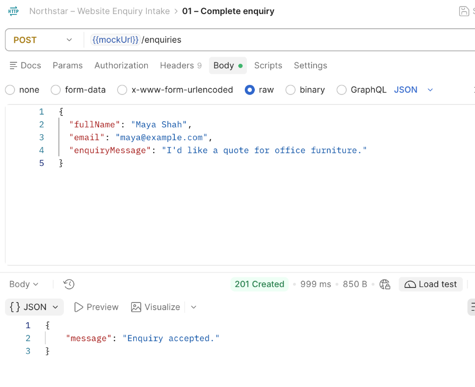
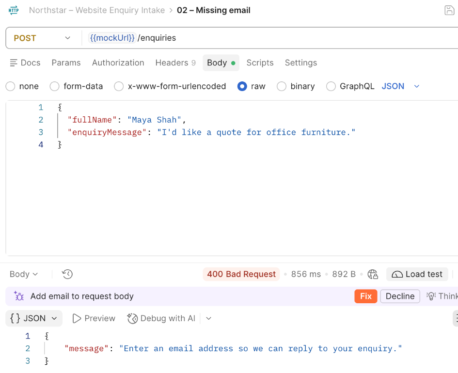

# Artefact 009 Website Enquiry Intake API Mock

**Author** Varun Kumar Darbari

**Project** Northstar Customer 360, an independent fictional IT Business Analysis case study

**Milestone** Session 9, two Postman mock checks executed on 25 November 2026

## Business purpose

Northstar's website is one of several channels for sales enquiries. To follow up on a website enquiry by email, Sales needs a contact address and enough context to understand what the customer is asking for. I used one fictional office furniture quote enquiry to specify what the form would pass to the receiving system and what reply the website should receive.

[Artefact 005](05-customer-data-model-and-quality-analysis.md) uses synthetic SQL data to compare submissions with Sales records. [Artefact 008](08-mvp-verification-and-case-study-review.md) shows how Sales manages enquiries already recorded in the Salesforce demo. This exercise covers the proposed website intake step before a record would reach Salesforce.

## Proposed request and data mapping

A website would submit the details as JSON, a text format that labels each value. Both Postman requests used `POST /enquiries`. Here, POST represents submitting a new enquiry, and `/enquiries` identifies where the receiving system expects it.

| Website field | JSON field | Proposed requirement | Business reason |
| --- | --- | --- | --- |
| Name | `fullName` | Required text | Lets Sales address the customer by name |
| Email | `email` | Required text | Gives Sales an address for the reply |
| Enquiry message | `enquiryMessage` | Required text | Explains what the customer is asking for |

Test 01 used this complete fictional enquiry.

```json
{
  "fullName": "Maya Shah",
  "email": "maya@example.com",
  "enquiryMessage": "I'd like a quote for office furniture."
}
```

Test 02 sent the same name and message with the `email` field omitted entirely.

```json
{
  "fullName": "Maya Shah",
  "enquiryMessage": "I'd like a quote for office furniture."
}
```

## Postman setup

I saved both requests in the **Northstar – Website Enquiry Intake** collection. Each request had a saved example pairing its JSON body with a status code and reply. I set up a Postman collection mock and enabled request body matching, so the mock could distinguish the examples even though both requests used the same method and path.

To repeat the checks in a Postman workspace, point the collection variable `mockUrl` at its mock server, keep the `/enquiries` path in both requests, and use `Content-Type: application/json` for the requests and their saved examples. Send each saved request and compare the status and message in the response panel with the expected values below.

## Expected and observed results

| Case | Expected reply | Observed reply | Outcome |
| --- | --- | --- | --- |
| 01 Complete enquiry | `201 Created` and “Enquiry accepted.” | `201 Created` and “Enquiry accepted.” | Pass |
| 02 Missing email | `400 Bad Request` and “Enter an email address so we can reply to your enquiry.” | `400 Bad Request` and “Enter an email address so we can reply to your enquiry.” | Pass |

The second case passed because the planned outcome was rejection with a message the customer could act on.

### Evidence 01 Complete enquiry



[Open the complete enquiry evidence](../assets/evidence/09-e01-complete-enquiry.png)

### Evidence 02 Missing email



[Open the missing email evidence](../assets/evidence/09-e02-missing-email.png)

## Verification scope

The two runs show that the Postman mock returned the planned replies for these specific sample bodies. The mock selects saved examples. General required-field enforcement belongs to a future implementation, including separate checks for empty and invalid email values and missing name or message. The live website, Salesforce record creation, customer matching and email delivery remain outside this exercise.
