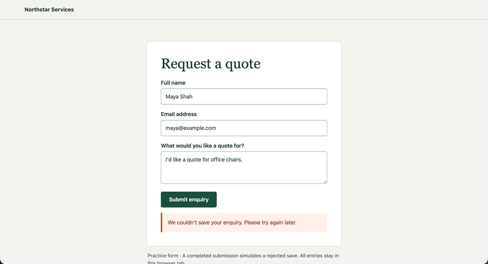

# Artefact 013 Checking the Customer Enquiry Failure Message

**Author** Varun Kumar Darbari

**Result** Pass in the practice form on 28 November 2026.

## The customer’s question

Maya Shah has supplied a valid reply address and asked for a quote for office chairs. If the save fails but the form says her enquiry was submitted, she may wait for a call that Sales has no reason to make. In [Artefact 012](12-rejected-enquiry-verification.md), I verified what Sales could find after a rejected API submission. Here I checked what Maya could see when a form simulated that outcome.

## Acceptance criterion

**Given** Maya has entered her name, a valid email address and her request for an office-chair quote, **when** the form receives a confirmed rejection, **then** it should show “We couldn’t save your enquiry. Please try again later.”

The first sentence tells Maya what happened. The second gives her a next step. Asking her to correct her email would be misleading because she supplied a valid address.

## Test and observation

I opened the practice form with Maya’s fictional details and selected **Submit enquiry**. The form simulated a rejected save in the browser. I compared the text below the button with the acceptance criterion.

| Check | Observed result |
| --- | --- |
| Customer message | “We couldn’t save your enquiry. Please try again later.” Exact match. |
| Details visible after submission | Maya Shah, maya@example.com and “I'd like a quote for office chairs.” remained visible. |

[Open the test screenshot](../assets/evidence/13-form-rejection.png) · [Try the practice form](../demo/enquiry.html)

## What this establishes

The practice form displayed the agreed wording for a simulated rejection. The earlier Salesforce test established that a direct API request with an unrecognised field was rejected and left no matching enquiry. A single submission from a connected form through to Salesforce still needs verification, as does the result of retrying.
